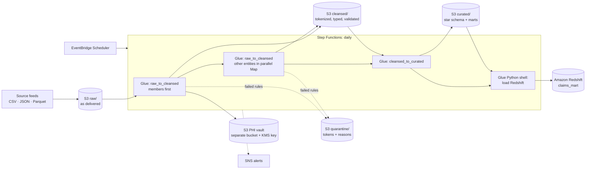

# AWS Healthcare Claims Pipeline

[](https://github.com/sumaksharikaa/aws-healthcare-claims-pipeline/actions/workflows/ci.yml)


This is an end-to-end **health-plan claims pipeline** built the way it would run on AWS:
**AWS Glue (PySpark)** jobs move data through **S3** zones, **Step Functions** orchestrates them,
and curated marts load into **Amazon Redshift**. PHI is protected throughout.

It ingests members, eligibility, providers, medical claims (headers + lines) and pharmacy claims, and
handles what real payer data throws at you: duplicate submissions, replacement and void claims, invalid
ICD-10 codes, NPIs that fail their check digit, services outside coverage, unknown members and
negative payments.

> **Note:** this is a personal portfolio project. All data is synthetic, produced by the included generator
> (SSNs use the never-issued 900–999 range). No real PHI or client code is involved.

---

## Architecture



| Zone | Contents | Notes |
|---|---|---|
| `raw/` | Files exactly as received | Restricted, replayable; moves to Glacier IR after 90 days |
| `phi_vault/` | Direct identifiers ↔ `member_token` | Separate bucket and KMS key; the only place names and SSNs exist after raw |
| `cleansed/` | Typed, validated, de-duplicated, tokenized | Partitioned by `batch_date`; dynamic partition overwrite makes re-runs idempotent |
| `quarantine/` | Rows that failed rules, with the failed rule names | Tokens only, no identifiers |
| `curated/` | Dimensional model and marts | Column order matches the Redshift DDL; loaded with `COPY … FORMAT AS PARQUET` |

## What it demonstrates

**Healthcare domain logic**
- **Claim adjustments.** Originals (frequency code 1), replacements (7) and voids (8) are grouped into claim families,
  and only the current version reaches the facts. Voided claims are excluded and the version count is kept for auditing.
- **Eligibility range join.** Each claim is checked against coverage spans on its service date. Ineligible claims are
  *flagged*, not dropped, so they still show up for recovery reporting.
- **Code validation as native Spark expressions.** The NPI check digit (Luhn over the `80840` prefix) uses
  `transform`/`aggregate` higher-order functions with no Python UDF. ICD-10-CM structure, CPT and NDC formats are
  validated too.
- **Point-in-time membership.** `dim_member` is SCD Type 2, so each claim line carries the plan the member was on
  *on the date of service*.
- **Cost marts.** Member-month medical and Rx paid, PMPM by plan, and ranked high-cost claimants.

**PHI protection (HIPAA-minded)**
- Direct identifiers are split into a **PHI vault**. Everything downstream uses `member_token`, a keyed SHA-256 whose
  key lives in **AWS Secrets Manager**.
- Quasi-identifiers are generalized Safe-Harbor style: date of birth becomes birth year plus age band, and ZIP is cut to ZIP3.
- A **guardrail** (`assert_no_direct_identifiers`) runs before every write outside raw and the vault. A test checks
  every cleansed, quarantine and curated table.
- Infrastructure: SSE-KMS on every bucket, separate keys for the vault, TLS-only bucket policies, public access blocked,
  versioning, and least-privilege IAM.

**Engineering**
- **Idempotent everywhere.** Dynamic partition overwrite on `batch_date`, the curated layer rebuilt from cleansed, and
  Redshift loads go `COPY` into a staging table, then `DELETE` + `INSERT` in one transaction, so readers never see a
  half-loaded table and claims voided later disappear from Redshift too. Re-running any day changes nothing (tested).
- **Declarative data quality.** 26 rules in [`conf/pipeline.yaml`](conf/pipeline.yaml) (`not_null`, `regex`,
  `accepted_values`, `range`, `expression`, `foreign_key`). Every failure reason is kept, and per-rule counts and
  duplicates removed go to an audit table.
- **Orchestration.** A Step Functions workflow runs members first (other entities validate against it), then the rest
  in a parallel `Map`, with retries on Glue throttling and SNS alerts on success or failure.
- **Infrastructure as code.** Terraform for KMS, S3, Secrets Manager, Glue jobs, IAM, Step Functions, SNS and EventBridge Scheduler.
- **CI.** Ruff, 24 tests including a full end-to-end run, `terraform validate`, and a wheel build.

## Results from a sample run

3 daily batches, 2,000 members, ~9.3k claims, ~20k service lines, 4.5k Rx fills, generated with `make demo`:

| Check | Result |
|---|---|
| Claim headers received → cleansed | 9,340 → 9,272 (60 duplicates removed, 8 quarantined) |
| Quarantine reasons caught | invalid ICD-10, unknown member, bad NPI check digit, future service date, negative paid, malformed NDC, future DOB, missing member id |
| Claim families after adjustments | 8,910 current (173 adjusted to their latest version, voided claims excluded) |
| Claims outside coverage on date of service | 676 flagged |
| Claim lines without a member version | 0 |
| `dim_member` SCD2 rows | 2,157 (2,000 current, 157 history) |
| Direct identifiers outside the vault | none (enforced + tested) |
| Re-run of a day | identical row counts (tested) |

```
raw_to_cleansed  claims      2026-11-02 SUCCEEDED  in=3125 dupes=30 quarantined=4 out=3091
    {"dx_icd10_format": 1, "member_known": 1, "npi_check_digit": 1, "service_dates_ordered": 1, "service_not_in_future": 1}
raw_to_cleansed  claim_lines 2026-11-02 SUCCEEDED  in=6692 dupes=0  quarantined=4 out=6688  {"paid_not_negative": 4}
raw_to_cleansed  pharmacy    2026-11-02 SUCCEEDED  in=1501 dupes=0  quarantined=5 out=1496  {"member_known": 4, "ndc_format": 1}
```

## Quickstart (local, no AWS account needed)

Requirements: Python 3.10+ and Java 17.

```bash
git clone https://github.com/sumaksharikaa/aws-healthcare-claims-pipeline.git
cd aws-healthcare-claims-pipeline
python -m venv .venv && source .venv/bin/activate
make install     # pip install -e ".[local,dev]"
make demo        # generate 3 days of data, run raw -> cleansed -> curated into ./data
make test        # 24 tests, including the end-to-end pipeline
make redshift-sql   # print the transactional Redshift load SQL
```

Look at the results:

```python
from claims_pipeline.spark import get_spark

spark = get_spark()
spark.read.parquet("data/curated/agg_plan_month").orderBy("plan_id", "service_month").show()
spark.read.parquet("data/quarantine/claims").select("claim_id", "_dq_errors").show(truncate=False)
spark.read.parquet("data/audit/pipeline_runs").show(truncate=False)
```

## Deploying to AWS

1. `cd infra/terraform && terraform init && terraform apply -var alert_email=you@example.com`
2. Put a random tokenization key in the `claims-pipeline/phi-tokenization-key` secret.
3. Build and upload the code: `make wheel`, then copy `dist/*.whl`, `conf/pipeline.yaml` and
   `src/claims_pipeline/jobs/*.py` to `s3://<lake-bucket>/code/`.
4. Create the Redshift objects with [`sql/redshift/ddl.sql`](sql/redshift/ddl.sql), and set `redshift_s3_role_arn` /
   `redshift_workgroup`.
5. The EventBridge schedule starts the state machine daily. To run a specific day:
   `aws stepfunctions start-execution --state-machine-arn <arn> --input '{"batch_date":"2026-11-02","entities":["providers","eligibility","claims","claim_lines","pharmacy"]}'`

Example analytics queries (PMPM trend, ineligible paid, provider cost index, plan history) are in
[`sql/redshift/analytics_queries.sql`](sql/redshift/analytics_queries.sql).

## Project structure

```
├── conf/pipeline.yaml                 # zones, PHI settings, 26 data-quality rules
├── data_generator/                    # synthetic payer data with injected defects
├── src/claims_pipeline/
│   ├── transforms.py                  # conform, dedupe, claim versions, eligibility join
│   ├── validation.py                  # NPI Luhn, ICD-10 (native Spark expressions)
│   ├── phi.py                         # tokenization, vault split, generalization, guardrail
│   ├── quality.py                     # declarative rules + quarantine
│   ├── marts.py                       # SCD2 dim_member, facts, PMPM, high-cost claimants
│   ├── redshift.py                    # transactional COPY/merge via Redshift Data API
│   ├── pipeline.py                    # stages, audit log, CLI
│   └── jobs/                          # AWS Glue job entry points
├── sql/redshift/                      # DDL (dist/sort keys) + analytics queries
├── infra/step_functions/              # state machine (ASL)
├── infra/terraform/                   # KMS, S3, Glue, IAM, SFN, SNS, Scheduler
└── tests/                             # unit + end-to-end
```

## Design notes

- **Why tokens rather than encryption:** analytics needs stable join keys, not reversibility. A keyed hash gives
  both, and the key sits in Secrets Manager behind its own KMS key, so the analytics account cannot rebuild identities.
- **Flag, don't drop, ineligible claims:** coverage gaps are a business outcome (pend, deny or recover), not a data
  error. Only structurally invalid data is quarantined.
- **Curated is rebuilt from cleansed:** simple and always consistent at this volume. At production scale the facts would
  move to Apache Iceberg tables with `MERGE` on the affected service months.

## License

MIT
